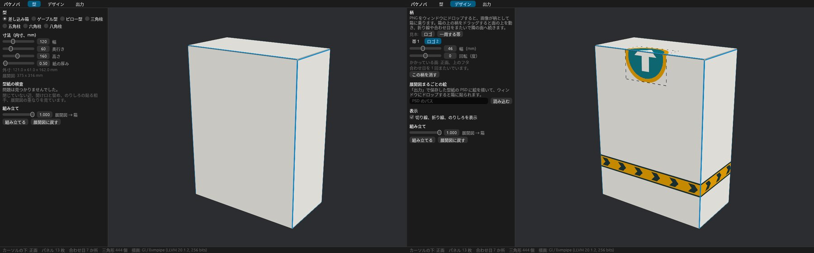
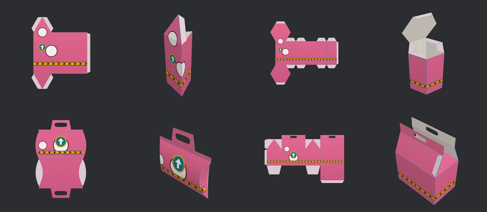

# 新パケノバ

パッケージデザイン専用の制作ソフト「パケノバ」の作り直しです。箱の形（型紙）を決め、立体の上で柄を置き、見せるための画像や動画を書き出すところまでを1本で行うことを目指します。

現在は、本番の土台を作りはじめた段階です。計算の中核（`crates/pakenoba-core`）と、画面の骨組み（`crates/pakenoba-app`）があります。



左は「型」、右は「デザイン」のワークスペース。Linux の仮想画面で撮ったものです。

## 動かし方

```
cargo run --release -p pakenoba-app
```

- **型**: 箱の形と寸法を決めます。型紙の検査の結果が出ます。
- **デザイン**: PNG をウィンドウにドロップすると、柄として箱に乗ります。箱の上でドラッグして動かせます。型紙の PSD に描いた絵を貼ることもできます。
- **出力**: 型紙を、レイヤーに分けた PSD で保存します。見せるための画像や動画の書き出しは、まだありません。

## 構成

| 場所 | 内容 |
|---|---|
| `crates/pakenoba-core` | 中核。型紙、折りの計算、面のつながり、型紙の検査。画面や描画には依存しない |
| `crates/pakenoba-app` | アプリ本体。ウィンドウ、立体の表示、柄の描き込み、PSD の読み書き |
| `docs/` | 方針メモと調査メモ |
| `spikes/` | 使い捨ての試作（S01〜S06）。それぞれ独立して動く |

テストは、次のコマンドで動きます。

```
cargo test --workspace
```

### 型の状態

型紙は、形が閉じるだけでなく、箱として成り立つかを検査します。見るのは、閉じていない辺がないか、開け口があって留まっているか、のりしろの貼る相手が決まっているか、展開図の上でパネルが重なっていないか、の 4 つです。

| 型 | 状態 |
|---|---|
| 差し込み箱 | 検査を通る |
| 角柱（三角柱〜八角柱） | 検査を通る。フタに差し込みを付けた |
| ピロー型 | 検査を通る。上の端を、端から端まで貼りしろで閉じる作りにした |
| ゲーブル型 | 検査を通る。左奥の三角形を左側面の上へ移し、のりしろを屋根まで延ばした。持ち手の留めの形は未作成 |
| 丸みのある手提げ型 | 下書き。開け口が決まっておらず、上の端が閉じていない |

下書きの型は、直すまで画面の型の一覧に出しません。



上段は三角柱と六角柱（展開図と、フタを閉じる途中）。下段はピロー型（展開図と完成）とゲーブル型（展開図と、屋根を閉じる途中）。試作の画面を一時的に流用して、Linux の仮想画面で撮ったものです。

## 文書

- [方針メモ](docs/concept.md): 何を作るか、決定事項、設計の提案、未決事項
- [PhotoCraft / VectorCraft 調査メモ](docs/upstream-investigation.md): 部品として使える範囲と、編集画面を内蔵できるかの調査結果

## 試作

本番のコードではありません。設計が成り立つかを確かめたときの記録です。

- [S01 土台の確認](spikes/s01-foundation/README.md): 箱の表示、PSD の貼り付け、日本語入力、動画書き出し
- [S02 型紙から厚みのある箱を折る](spikes/s02-fold/README.md): 型紙のデータ、厚みつきの折り、開き具合、wgpu 描画
- [S03 曲面を含む型（手提げ型）](spikes/s03-curved/README.md): パネルの丸め、山折り、抜き穴
- [S04 ゲーブル型と、開ける動き](spikes/s04-gable/README.md): 組み立てと開け閉めの分離、連動する折り線、寸法の変更
- [S05 曲線の折り線（持ち手つきピロー型）](spikes/s05-pillow/README.md): 曲線の折り線、折り線をまたぐ絵柄、寸法とふくらみの変更
- [S06 立体の上で柄を置く](spikes/s06-decals/README.md): パネル基準の柄、立体の上でのドラッグ、合わせ目の自動検出と、合わせ目をまたぐ配置

## 注意

このソフトが出力する型紙はデザイン確認用です。製造、抜型、裁断、印刷位置の保証に使える正式なデータではありません。

## ライセンス

コードは「MIT または Apache-2.0」です。どちらかを選んで使えます（[LICENSE-MIT](LICENSE-MIT)、[LICENSE-APACHE](LICENSE-APACHE)）。

「パケノバ」の名称とロゴは、コードのライセンスの対象外です。詳しくは [TRADEMARKS.md](TRADEMARKS.md) を見てください。
