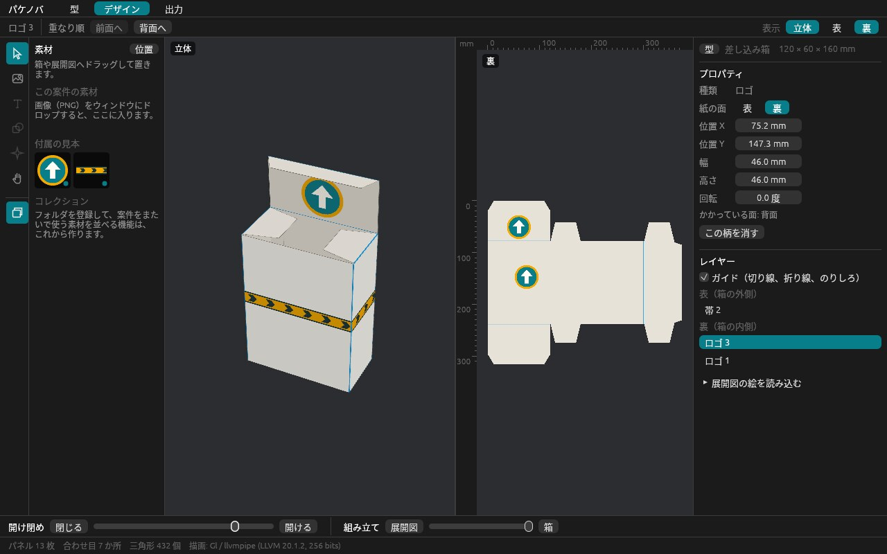

# 新パケノバ

パッケージデザイン専用の制作ソフト「パケノバ」の作り直しです。箱の形（型紙）を決め、立体の上で柄を置き、見せるための画像や動画を書き出すところまでを1本で行うことを目指します。

現在は、本番の土台を作りはじめた段階です。計算の中核（`crates/pakenoba-core`）と、画面（`crates/pakenoba-app`）があります。画面は、[画面設計の検討](docs/ui-design.md)で決めた並びに作り替えている途中です。



デザインの工程。左に道具と素材の欄、中央に立体と展開図（裏）、右に選んだ柄の設定とレイヤー、下に開け閉めと組み立て。ロゴは、素材の欄から、フタの裏と背面の内側へドラッグして置いたものです。Linux の仮想画面で撮ったものです。

## 動かし方

```
cargo run --release -p pakenoba-app
```

- **型**: 左で型を選び、右で寸法を決めます。型紙の検査の結果が出ます。
- **保存**: 上の「ファイル」から、案件を 1 つのファイル（`.pknb`）に保存して、あとで開けます（Ctrl+S、Ctrl+O）。新しい案件（Ctrl+N）と、最近使った案件の一覧もあります。置いた画像や、型紙に描いた絵も、そのファイルの中に入ります。保存していない変更は、30 秒ごとに別の場所へ控えを取り、パケノバが途中で終わっても、次に起動したときに開き直せます。
- **デザイン**: 画像（PNG、JPEG、PSD、SVG）をウィンドウにドロップすると、柄として箱に乗ります。立体でも展開図でも、ドラッグして動かせます。右で、位置、大きさ、回転を数値で合わせられます。パケノバが書き出した型紙の PSD に描いた絵は、展開図まるごとの絵として貼られます（裏の型紙に描いた絵は、紙の裏に）。レイヤーの欄で、差し替えたり外したりでき、元に戻せます。
  - 上の帯の右端の「立体」「表」「裏」で、それぞれの表示を出したり隠したりします。1、2、3 のキーで、その表示だけになります。
  - 画面は日本語と英語です。はじめは OS の言語に合わせ、「編集」→「環境設定」→「言語」で切り替えられます。訳は `crates/pakenoba-i18n/catalogs/` の表にあり、表を足せば言語を増やせます。
  - 道具は、選択（V）、文字（T）、図形（U）、手のひら（H）が使えます。生成AIは、まだありません。
  - 柄は、右の「紙の面」で、紙の裏（箱の内側。フタの裏など）へ移せます。裏の柄は、「裏」の表示か、フタを開けた箱の内側で、つかんで動かせます。
  - 画像の柄をダブルクリック（Ctrl+E）すると、外のアプリ（OS で決まっているアプリか、右の欄で選んだアプリ）で開きます。外のアプリで保存すると、箱に反映します。
  - 文字の道具（T）で箱や展開図を押すと、そこに文字を置けます。右の欄で文字を打ち、フォント・大きさ・色・揃え・字間・行送りを変えられます。フォントは OS に入っているものを使います。
  - 図形の道具（U）で箱や展開図を押すと、そこに四角か丸を置けます。上の帯か右の欄で、形、塗り、線、線の太さ、角の丸みを変えられます。拡大しても、ぼやけません。
  - 画像の柄を選ぶと、右の欄の「画像の調整」で、背景を透明にする、陰影をならす、色数を絞る、余白を切り落とす、ベクター化、ができます。元の素材は変えず、その柄だけを、調整した新しい素材に差し替えます（元に戻せます）。ベクター化は、VectorCraft の画像トレースを部品として使い、線の絵（SVG）にします。SVG の柄は拡大してもぼやけず、外のアプリ（VectorCraft など。画像とは別に選べます）で直せます。
  - Shift を押しながらクリックで、柄をいくつも選べます（Ctrl+A ですべて）。いっしょに動かす、消す、上の帯でそろえる・等間隔に並べる、ができます。柄にカーソルを置くと、立体・表・裏のすべてで同じ柄に枠が出ます。
  - 右のレイヤーの欄で、柄ごとに隠す（目）、ロックする（鍵）、名前を変える（ダブルクリック）、ドラッグで重なり順を変える、ができます。
  - Ctrl+Z で元に戻し、Ctrl+Shift+Z でやり直せます。Delete で、選んだ柄を消します。
  - 差し込み（ベロ）や内側のフラップにも、柄を置けます。のりしろには置けません。
  - 柄や素材を右クリックすると、素材を新しい画像に差し替えられます。その素材を使っている柄が、すべて新しい絵になります（この柄だけ、も選べます）。
  - 道具の帯の下のボタンで、素材の欄が開きます。素材をクリックすると、欄の下に大きく出ます。箱や展開図へドラッグすると、放したら置かれる姿が箱の上に出て、放すと置かれます。箱の内側の面や「裏」の表示に落とすと、紙の裏に置かれます。ドロップした画像（PNG、JPEG、PSD、SVG）は、素材の欄に入り、何度でも置けます。前の案件で使った画像は「最近使ったもの」に出ます。
- **素材の画面**: 上の帯の右端の「素材」（または素材の欄の「大きく開く」）で開きます。素材を入れているフォルダを「＋ 登録…」で登録すると、中の画像（PNG、JPEG、PSD、SVG）が大きな絵で並び、名前で探したり、新しい順に並べたりできます。「この案件に取り込む」（またはダブルクリック）で、案件の素材に入ります。フォルダの中身は動かしません。Esc で戻ります。
- **出力**: 型紙を、レイヤーに分けた PSD で保存します。紙の裏にも柄があれば、裏の型紙（裏から見た向き）も一緒に保存します。ほかに、いま見えている向きの箱の 16:9 の画像（PNG。背景は明るい灰色、白、透明）、閉じた箱が開く動きの動画（GIF。MP4 はまだ）、展開図を実寸で A4 や A3 に分けた PDF（重ねしろつき。展開図がかからない紙は刷らない）を書き出せます。PDF は「実際のサイズ」（100%）で刷ってください。「のぞき込み」では、Web カメラで見ている人の顔の場所を見て、画面を窓のようにして、その向こうに箱を見せます。頭を動かすと箱の横がのぞけ、近づくと大きく見えます。全画面にして、その場で見せる使い方です。カメラの映像は、このアプリの中で顔を見つけるのに使うだけで、保存も送信もしません。
- **立体の表示の下**: 「開け閉め」は買った人がフタを開ける動き、「組み立て」は展開図から箱までの動きです。開け閉めは、差し込み箱、角柱、ゲーブル型にあります。フタのあとに、内側のフラップも開きます。「底」で、底も同じように開けられます。ピロー型では、「左の口」「右の口」をそれぞれ開けられます。

## 構成

| 場所 | 内容 |
|---|---|
| `crates/pakenoba-core` | 中核。型紙、折りの計算、面のつながり、型紙の検査。画面や描画には依存しない |
| `crates/pakenoba-app` | アプリ本体。ウィンドウ、立体の表示、柄の描き込み、PSD の読み書き |
| `docs/` | 方針メモと調査メモ |
| `spikes/` | 使い捨ての試作（S01〜S06）。それぞれ独立して動く |

テストは、次のコマンドで動きます。

```
cargo test --workspace
```

### 型の状態

型紙は、形が閉じるだけでなく、箱として成り立つかを検査します。見るのは、閉じていない辺がないか、開け口があって留まっているか、のりしろの貼る相手が決まっているか、展開図の上でパネルが重なっていないか、の 4 つです。

| 型 | 状態 |
|---|---|
| 差し込み箱 | 検査を通る。上のフタが開く。のりしろ、左右のフラップ、差し込みの長さを変えられる |
| 角柱（三角柱〜八角柱） | 検査を通る。フタに差し込みを付けた。上のフタが開く |
| ピロー型 | 検査を通る。上の端を、端から端まで貼りしろで閉じる作りにした。開け閉めの動きは未作成 |
| ゲーブル型 | 検査を通る。左奥の三角形を左側面の上へ移し、のりしろを屋根まで延ばした。持ち手の留めの形は未作成 |
| 丸みのある手提げ型 | 下書き。開け口が決まっておらず、上の端が閉じていない |

下書きの型は、直すまで画面の型の一覧に出しません。


上段は三角柱と六角柱（展開図と、フタを閉じる途中）。下段はピロー型（展開図と完成）とゲーブル型（展開図と、屋根を閉じる途中）。試作の画面を一時的に流用して、Linux の仮想画面で撮ったものです。

## 文書

- [方針メモ](docs/concept.md): 何を作るか、決定事項、設計の提案、未決事項
- [画面設計の検討](docs/ui-design.md): 画面の並び、文字やツールチップの方針、決まったこと、実装の状態
- [案件の保存の検討](docs/project-file.md): 案件をファイル（`.pknb`）に残す形。画面からの開く、保存まで実装
- [PhotoCraft / VectorCraft 調査メモ](docs/upstream-investigation.md): 部品として使える範囲と、編集画面を内蔵できるかの調査結果

## 試作

本番のコードではありません。設計が成り立つかを確かめたときの記録です。

- [S01 土台の確認](spikes/s01-foundation/README.md): 箱の表示、PSD の貼り付け、日本語入力、動画書き出し
- [S02 型紙から厚みのある箱を折る](spikes/s02-fold/README.md): 型紙のデータ、厚みつきの折り、開き具合、wgpu 描画
- [S03 曲面を含む型（手提げ型）](spikes/s03-curved/README.md): パネルの丸め、山折り、抜き穴
- [S04 ゲーブル型と、開ける動き](spikes/s04-gable/README.md): 組み立てと開け閉めの分離、連動する折り線、寸法の変更
- [S05 曲線の折り線（持ち手つきピロー型）](spikes/s05-pillow/README.md): 曲線の折り線、折り線をまたぐ絵柄、寸法とふくらみの変更
- [S06 立体の上で柄を置く](spikes/s06-decals/README.md): パネル基準の柄、立体の上でのドラッグ、合わせ目の自動検出と、合わせ目をまたぐ配置

## 注意

このソフトが出力する型紙はデザイン確認用です。製造、抜型、裁断、印刷位置の保証に使える正式なデータではありません。

## ライセンス

コードは「MIT または Apache-2.0」です。どちらかを選んで使えます（[LICENSE-MIT](LICENSE-MIT)、[LICENSE-APACHE](LICENSE-APACHE)）。

のぞき込みの顔と目の検出には、MediaPipe BlazeFace のモデル（`crates/pakenoba-app/assets/blazeface-short-range-128.onnx`、Apache-2.0。Google の MediaPipe のモデルを PINTO0309 さんが ONNX にし、keijiro さんが手を入れたものを、tract で読めるように形を単純にした。条文は同じ場所の `blazeface-LICENSE.txt`）を同梱しています。

「パケノバ」の名称とロゴは、コードのライセンスの対象外です。詳しくは [TRADEMARKS.md](TRADEMARKS.md) を見てください。
