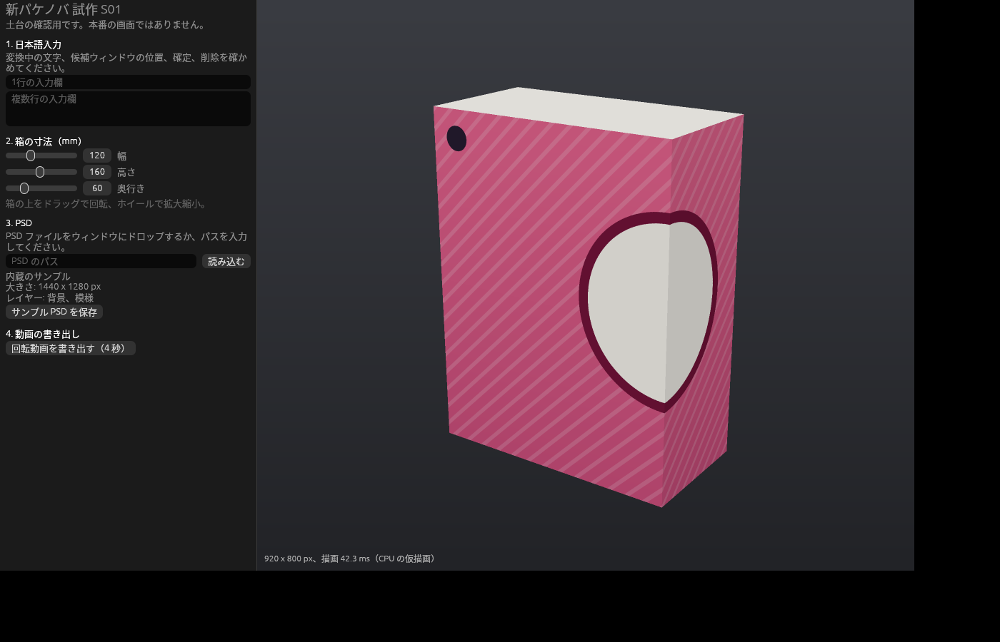

# 試作 S01: 土台の確認

新パケノバの土台が成立するかを確かめるための、使い捨ての試作です。本番のコードや画面ではありません。



## 確かめること

1. `craft-libs` の部品を、外部のアプリから特定コミット指定で使えるか
2. PSD を読んで箱の面に貼れるか
3. 日本語を入力できるか（特に Windows）
4. 外部ソフトなしで動画を書き出せるか

## 動かし方

Rust 1.95 以降が必要です。

```
cd spikes/s01-foundation
cargo run --release
```

初回は依存の取得とビルドに数分かかります。画面なしで PSD、静止画、動画だけを確かめるときは次のとおりです。

```
cargo run --release -- --headless out
```

## 結果（2026-11-20、Linux、CPU 2 コア）

| 項目 | 結果 |
|---|---|
| `craft-libs` をコミット `9eb02be8` 指定で取得してビルド | できた（`craft-psd`、`craft-media`、`craft-video`） |
| 全体の最適化ビルド | 4 分 12 秒 |
| PSD を作る（日本語名のレイヤー 2 枚と統合画像、1440 x 1280） | できた（624,500 バイト） |
| PSD を読んで書き戻すと元と同じバイト列になるか | なった |
| 統合画像とレイヤー名の取り出し | できた（2.2 ミリ秒） |
| 箱の面に貼り、正面から右側面へ柄を続ける | できた（`results/still.png`） |
| 動画の書き出し（1280 x 720、30 fps、4 秒、H.264 High） | できた（278 KB） |
| 圧縮の速さ | 1 フレームあたり 11.8 ミリ秒（毎秒 約 85 フレーム） |
| ffprobe での確認 | h264 High、yuv420p、bt709、30 fps、120 フレーム、4.0 秒 |
| ffmpeg での厳格な復号 | 警告なし |
| ウィンドウの表示（仮想画面、ソフトウェア描画） | できた。日本語の表示は OS のフォントで出る |
| 改変版の egui と winit に差し替えた型検査 | 通った（`egui-fork-patch.toml`） |

egui と eframe は本家の 0.37.0 を使っています。日本語のフォントは同梱しておらず、eframe の `system_fonts` 機能で OS のフォントを使っています。

## まだ確かめていないこと

そちらの PC で確かめてほしい項目です。

### Windows

1. ビルドが通り、ウィンドウが開くか。→ ビルドは通った（2026-11-21）。左のパネルが広がり続けて箱の表示が消える不具合が見つかり、修正した。修正後の表示は Windows では未確認。
2. 日本語入力。1 行の欄と複数行の欄の両方で、次を見てください。
   - 変換中の文字が入力欄に表示されるか
   - 変換候補のウィンドウが、入力位置の近くに出るか
   - Enter で確定したとき、余計な改行や二重入力が起きないか
   - Backspace、矢印キー、半角と全角の切り替えが普通に効くか
3. 手持ちの PSD をウィンドウにドロップして、箱に貼られるか。
4. 「サンプル PSD を保存」で出したファイルを Photoshop や Affinity で開いて、レイヤー「背景」「模様」が見えるか。
5. 「回転動画を書き出す」で出した MP4 が、標準のプレーヤーで再生できるか。

日本語入力に問題があれば、`egui-fork-patch.toml` の内容を `Cargo.toml` の末尾に貼って、もう一度試してください。本家と改変版のどちらで直るかが分かれば、どちらを土台にするかを決められます。

### macOS

同じ項目を、機会があるときに。

## 割り切ったところ

- 箱の描画は CPU で行う仮の実装です。画面表示と動画で同じ絵を出すことと、GPU のない環境でも確かめられることを優先しました。本番の 3D 描画は wgpu で作ります。
- 箱は厚みのない直方体だけです。型紙、折り、厚みは入っていません。
- PSD は統合画像を 1 枚の絵として貼るだけです。レイヤーごとの合成はしていません。統合画像の入っていない PSD（Photoshop で「互換性を優先」を切って保存したもの）は白く表示され、その旨を画面に出します。
- 柄は「正面から右側面へ続く 1 枚の帯」として貼っています。面またぎの見え方を確かめるための固定の割り当てです。
- 動画は B フレームなしで圧縮しています。

## ファイル

| ファイル | 内容 |
|---|---|
| `src/scene.rs` | 箱の形、カメラ、投影 |
| `src/raster.rs` | CPU の仮描画 |
| `src/psd_io.rs` | PSD の読み込みと、確認用 PSD の作成 |
| `src/video.rs` | H.264 での圧縮と MP4 への書き出し |
| `src/app.rs` | ウィンドウ |
| `src/headless.rs` | 画面なしの確認 |
| `egui-fork-patch.toml` | 改変版の egui と winit に差し替える設定 |
| `results/` | 上の結果を出したときの画像 |
