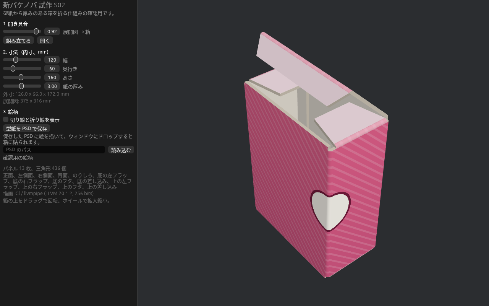
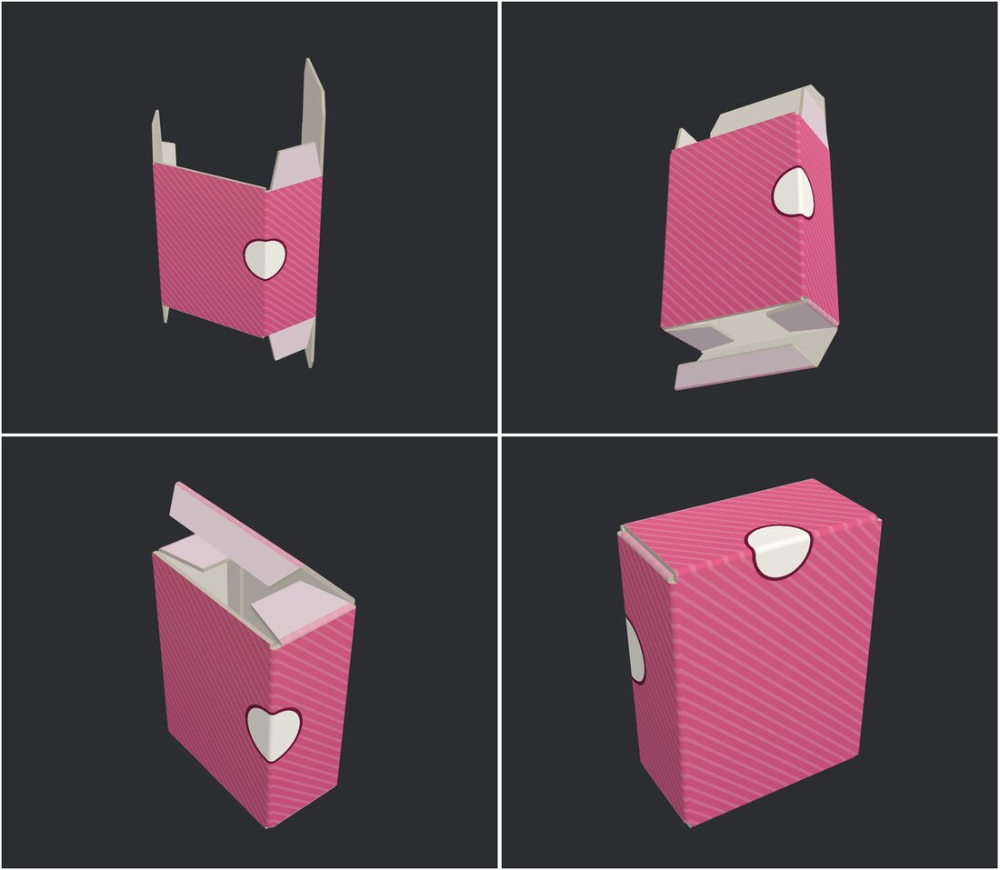

# 試作 S02: 型紙から厚みのある箱を折る

新パケノバの核になる仕組みが成り立つかを確かめるための、使い捨ての試作です。本番のコードや画面ではありません。



## 確かめること

1. 型紙（パネルと折り線）を正本にして、展開図と立体の両方を出せるか
2. 紙の厚みを、単純なルールで折りに反映できるか
3. 開き具合を連続的に変えられるか
4. wgpu で描けるか

## 動かし方

```
cd spikes/s02-fold
cargo run --release
```

検算用のテストは次のとおりです。

```
cargo test --release
```

画面を撮って確かめるときは、起動時の状態を指定できます。

```
cargo run --release -- --fold 0.5 --yaw 0.9 --pitch 0.7 --thickness 3 --no-guides
```

## 画面でできること

- 開き具合のスライダーで、展開図から箱までを連続的に動かす。「組み立てる」「開く」で約 3 秒かけて動く。
- 幅、奥行き、高さ、紙の厚みを変える。型紙と絵柄がその場で作り直される。
- 切り線と折り線の表示を切り替える。
- 「型紙を PSD で保存」で、絵柄とガイドの 2 レイヤーを持つ PSD を書き出す。
- 絵を描いた PSD をウィンドウにドロップすると、展開図まるごとの絵として箱に貼られる。

## 仕組み

### 型紙

型紙は、パネルの木です。根のパネル（正面）から、折り線でつながったパネルをたどります。

| 持つもの | 内容 |
|---|---|
| パネル | 名前、輪郭（展開図上の凸多角形）、親とのつながり |
| つながり（折り線） | 親パネル、折り線の両端、折りきったときの角度、折りが進む区間 |

箱の種類ごとの知識は、型を作る関数（`Template::tuck_box`）に閉じています。折る計算、形の生成、描画は、型紙のデータだけを見て動きます。

### 折り

各パネルの位置は「親の位置 × 折り線まわりの回転」で決まります。開き具合 0〜1 に対して、折り線ごとに折りが進む区間を決めてあり、側面、底、上の順に閉じます。

### 厚み

紙は、外側（印刷面）から内側へ厚みを持つ板として扱います。

- 谷折りの軸は内側の面に置く。内寸は折り線の間隔そのままになり、外寸は紙の厚みぶん大きくなる。
- 折り線の外側にできるすき間は、円弧の面で埋める。角が丸くなり、絵柄は折り線上の色を引き伸ばして続ける。
- 紙どうしが重なる場所は、型を作るときに紙 1 枚ぶんずらす。この箱では 3 か所。

| 重なる場所 | ずらし方 |
|---|---|
| のりしろと背面 | 左側面を 1 枚ぶん短く、背面を 1 枚ぶん長くする |
| 左右のフラップとフタ | 正面と背面を、上下に 1 枚ぶんずつ高くする |
| 差し込み（ベロ）と正面 | フタを 1 枚ぶん短くする。左右のフラップは正面側を空ける |

### 描画

egui の画面とは別のテクスチャに wgpu で描き、結果を egui に画像として渡しています。4 倍のマルチサンプルと奥行きバッファを使っています。この形は、動画書き出しにそのまま転用できます。

## 結果（2026-11-21、Linux、仮想画面、ソフトウェア描画）



| 項目 | 結果 |
|---|---|
| 展開図（開き具合 0）で、どのパネルも元の位置のまま | テストで確認 |
| 閉じたとき、4 つの側面が箱になり、背面の端が左側面の外側とそろう | テストで確認 |
| のりしろの外側が、背面の内側にぴったり付く | テストで確認 |
| フタの内側が、左右のフラップより紙 1 枚ぶん上に来る | テストで確認 |
| 差し込みの外側が、正面の内側に付く（上と底の両方） | テストで確認 |
| 型紙の PSD を書いて読み戻すと、大きさとレイヤー名が保たれる | テストで確認 |
| wgpu での描画（OpenGL、llvmpipe） | できた |
| 折りの途中と、閉じた状態の見た目 | 画面を撮って確認（上の画像） |
| 折り線をまたぐ円が、角の丸みを越えて続く | 画面を撮って確認 |

テストは 6 件で、すべて通っています。

## まだ確かめていないこと

- Windows 実機での描画（DirectX または Vulkan）と操作感。
- ドラッグでの回転、ホイールでの拡大縮小、「組み立てる」「開く」の動き。仮想画面では入力を送れないため、未確認。
- 型紙の PSD を Affinity で開き、絵を描いて戻す流れ。

## 割り切ったところ

- 折りの途中で、紙どうしがすり抜ける瞬間があります（フタを閉じるときの差し込みなど）。実物は紙がしなって逃げますが、この試作は板として回しているだけです。閉じた状態と展開図では重なりません。
- 対応しているのは谷折りだけです。山折りと、180 度の折り返しは入っていません。同じ仕組みで足せる見込みです。
- パネルの輪郭は凸多角形だけです。穴や、へこんだ形は入っていません。
- のりしろ側の角に、紙 1 枚ぶんの小さな欠けがあります。厚みを単純なルールで扱っているためです。
- 絵柄は外側の 1 面だけです。内側の印刷は入っていません。
- 絵柄は「展開図まるごと 1 枚」として持っています。柄をパネル基準で持つ仕組みと、合わせ目をまたぐ配置は入っていません。
- 切り線と折り線を表示すると、角の丸みが折り線の色（青）になります。絵柄を折り線上の色で引き伸ばしているためです。

## 分かったこと

- 「型紙が正本で、展開図も立体も同じ型紙の 2 つの見え方」という設計は成り立ちます。開き具合を変えるだけで、同じデータから両方が出ます。
- 箱の種類ごとの知識は「型を作る関数」に閉じ込められます。型を足すときに、折る計算や描画を触る必要はありません。
- 厚みは「軸を内側の面に置く」「外側を円弧で埋める」「重なる場所を 1 枚ぶんずらす」の 3 つで、デザイン確認用としては十分な見た目になります。
- 「重なる場所を 1 枚ぶんずらす」は型ごとに考える必要があり、ここが型を足すときの手間の中心になります。

## ファイル

| ファイル | 内容 |
|---|---|
| `src/template.rs` | 型紙のデータ、差し込み箱の型、折りの計算、形の生成、テスト |
| `src/art.rs` | 確認用の絵柄、ガイド線、PSD の読み書き、テスト |
| `src/gpu.rs` | wgpu での描画 |
| `src/math.rs` | ベクトルと変換 |
| `src/app.rs` | ウィンドウ |
| `results/` | 上の結果を出したときの画像 |
