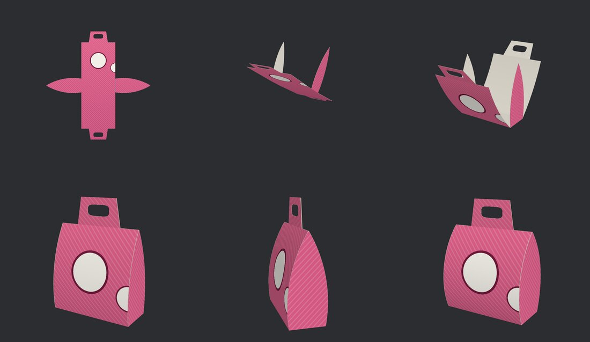

# 試作 S03: 曲面を含む型（手提げ型）

紙がしなって曲面になる箱を、試作 S02 と同じ枠組みで扱えるかを確かめるための、使い捨ての試作です。本番のコードや画面ではありません。



上段は左から、展開図、折りの途中 2 場面。下段は左から、閉じた状態、横から見た状態、ふくらみを大きくした状態です。

## 確かめること

1. 型紙の定義を「平らなパネルの集まり」から広げて、曲面を含む型を同じ枠組みに収められるか
2. 曲げても、展開図上の位置と立体上の位置が一対一のままか（絵柄が伸び縮みしないか）
3. 編集や描画の側を、型ごとに書き分けずに済むか

## 動かし方

```
cd spikes/s03-curved
cargo run --release
```

検算用のテストは `cargo test --release` です。起動時の状態は、S02 と同じ指定に加えて `--bulge 度` でふくらみを指定できます。

## 画面でできること

S02 の内容に、次が加わっています。

- 型に「手提げ型」を追加。起動時はこれが選ばれている。
- 「ふくらみ」のスライダーで、正面と背面の丸みを 0〜75 度で変える。0 なら平らな三角屋根になる。
- 持ち手の穴が、展開図と立体の両方で抜けて見える。

## 仕組み

### 丸め

パネルに「丸め」を持たせられるようにしました。親との折り線に平行な線をまっすぐ保ったまま、折り線から離れるほど一定の曲がり具合で巻いていきます。できる面は円筒の一部です。

これに合わせて、パネルの置かれ方の表し方を変えています。

| | S02 | S03 |
|---|---|---|
| パネルの置かれ方 | パネル 1 枚につき、変換 1 つ | 展開図上の点を渡すと、その点の近くを立体へ運ぶ変換を返す |
| 平らなパネル | 同じ変換をそのまま使う | どの点でも同じ変換が返る |
| 丸めたパネル | 表せない | 折り線からの距離に応じて、巻いたぶん回した変換が返る |

形の生成と描画は「点ごとの変換をもらって運ぶ」だけなので、平らでも丸くても同じコードで動きます。丸めたパネルは、折り線に平行な細片（1 片あたり約 4 度）に分けてから面を張ります。

### 手提げ型の形

- 底は平らな長方形。正面と背面は、底との折り線から丸みを持って立ち上がり、上で合わさる。
- 立ち上がる角度は、上の端がちょうど中央で合わさるように、ふくらみから逆算する。
- 持ち手は、正面と背面の上端から山折りでまっすぐ上に伸び、2 枚が背中合わせに重なる。
- 左右は、正面と背面の断面と同じ形（上がとがったアーチ形）の平らな側面でふさぐ。

### S02 から足したもの

| 足したもの | 理由 |
|---|---|
| 丸め | 正面と背面の曲面 |
| 山折り（軸を外側の面に置き、内側のすき間を円弧で埋める） | 持ち手の付け根 |
| 抜き穴（描くときに、穴の中の画素を捨てる） | 持ち手の穴 |
| 組み上がるにつれて全体を倒す | 展開図では印刷面を手前に向け、組み上がったら底を水平に寝かせるため |

差し込み箱と正多角柱の型は、S02 のまま動きます。

## 結果（2026-11-21、Linux、仮想画面、ソフトウェア描画）

| 項目 | 結果 |
|---|---|
| ふくらみ 0、23、46、69 度で、2 枚の持ち手の内側が中央でぴったり合わさる | テストで確認 |
| 同じく、持ち手がまっすぐ上に立つ | テストで確認 |
| 正面を丸めても、紙の上での長さが変わらない（誤差 0.05 mm 未満） | テストで確認 |
| 側面が、底の端からまっすぐ立つ | テストで確認 |
| 差し込み箱と正多角柱が、S02 と同じ結果になる | テストで確認 |
| 展開図、折りの途中、閉じた状態、ふくらみ違いの見た目 | 画面を撮って確認（上の画像） |
| 持ち手の穴が抜けて見える | 画面を撮って確認 |

テストは 9 件で、すべて通っています。

## 実物の手提げ箱との違い

参考にした写真の箱を、そのまま再現したものではありません。曲面の仕組みを確かめるために、形を単純にしています。

| 写真の箱 | この試作 |
|---|---|
| 正面と背面は、上へ行くほど幅が狭い台形 | 長方形（幅が一定） |
| 左右は、曲線の折り線で内側へ折り込んだ形 | 平らな側面でふさいだ形 |
| のりしろや差し込みで組み立てる | 組み立てのための部分は省略 |

残っている難しさは「曲線の折り線」です。折り線が曲線になると、その両側が円すいや円筒の面になり、今回の「折り線に平行に巻く」だけでは表せません。型ごとに専用の計算を足す必要があります。台形にするだけなら、今の仕組みのまま輪郭を変えれば済みます（その場合、左右の側面は平らではなくなります）。

## 割り切ったところ

- 丸めは「一定の曲がり具合で巻く」だけです。場所によって曲がり具合が変わる面は表せません。
- 丸めたパネルにつながる子パネルは、折り線が巻く軸と平行なものだけです（持ち手がこれにあたります）。
- 折りの途中は、角度と曲がり具合を同じ調子で変えているだけです。途中の形は実物と一致しません。閉じた状態と展開図は合っています。
- 抜き穴は 2 個までで、形は角の丸い四角だけです。穴の内側の断面（紙の厚み）は描いていません。
- 側面の縁にある円は、端で切れています。展開図では離れている面どうしをまたぐ配置は、まだ入っていません。

## 分かったこと

- 型紙の定義を「展開図上の点が、立体のどこに来るかを返すもの」にすれば、平らなパネルも曲面も同じ枠組みに収まります。方針メモの設計の提案どおりです。
- 紙が伸び縮みしない曲げ方（円筒）なら、展開図と立体の対応は一対一のままで、絵柄もゆがみません。立体上で柄を置く操作を、曲面でも同じように作れる見込みです。
- 曲面の型は、閉じた形を決める計算（ここでは立ち上がる角度の逆算）が型ごとに要ります。平らな箱の「重なる場所を 1 枚ぶんずらす」にあたる手間です。
- 曲線の折り線を持つ型は、もう一段の仕組みが要ります。型のカタログに入れる順番を考えるときの判断材料になります。

## ファイル

| ファイル | 内容 |
|---|---|
| `src/template.rs` | 型紙のデータ、3 種類の型、折りと丸めの計算、形の生成、テスト |
| `src/art.rs` | 確認用の絵柄、ガイド線、PSD の読み書き、テスト |
| `src/gpu.rs` | wgpu での描画（抜き穴を含む） |
| `src/math.rs` | ベクトルと変換 |
| `src/app.rs` | ウィンドウ |
| `results/` | 上の結果を出したときの画像 |
