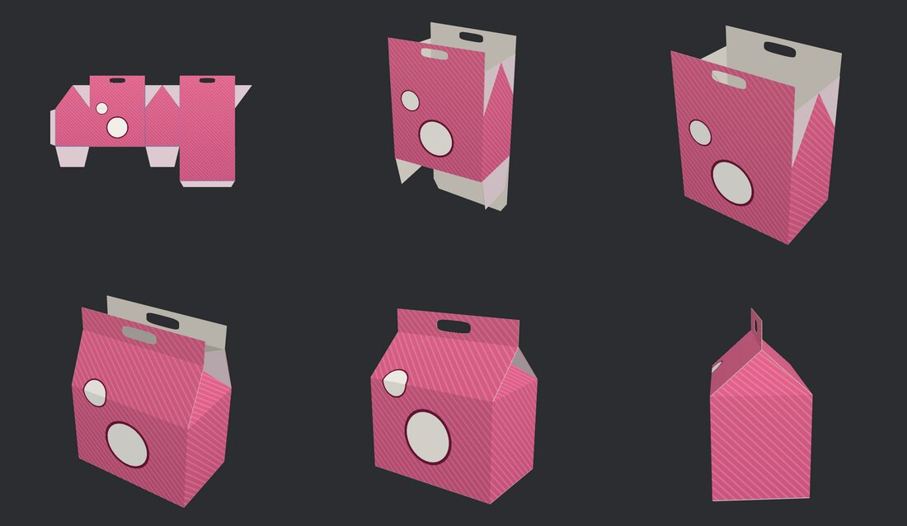

# 試作 S04: ゲーブル型と、開ける動き

「工場で組み立てる動き」と「お客さんが開ける動き」を分けて持てるかを、ゲーブル型（屋根の形に閉じる手提げ箱）で確かめるための、使い捨ての試作です。本番のコードや画面ではありません。



上段は左から、展開図、組み立ての途中、組み上がって屋根が開いた状態。下段は左から、屋根を半分閉じた状態、閉じた状態、横から見た状態です。

## 確かめること

1. 型紙に「製造時に固定する折り」と「お客さんが動かす折り」の区別を持たせられるか
2. 組み立ての動きとは別に、開ける動きを持てるか
3. ゲーブル型の屋根のように、複数の折り線が連動する動きを扱えるか
4. 寸法を数値で変えても、形が破綻しないか

## 動かし方

```
cd spikes/s04-gable
cargo run --release
```

検算用のテストは `cargo test --release` です。起動時の状態は、これまでの指定に加えて `--open 0〜1` で開けた度合いを指定できます。

## 画面でできること

- スライダーが 2 本になりました。「組み立て（製造）」は展開図から箱まで、「お客さんが開ける」は閉じた状態から開いた状態までを動かします。
- 「開ける」「閉じる」で、屋根が約 1.5 秒かけて動きます。
- 型に「ゲーブル型」を追加。幅、奥行き、胴の高さ、屋根の高さ、紙の厚みを変えられます。
- これまでの型（丸みのある手提げ型、差し込み箱、正多角柱）もそのまま選べます。これらはまだ、開ける動きを持っていません。

## 仕組み

### 2 つの動き

折り線ごとに、2 種類の角度を持たせました。

| | 組み立て（製造） | 開け閉め（お客さん） |
|---|---|---|
| 何を表すか | 平らな紙を折って、箱にする | できあがった箱を、開けて閉じる |
| 動く折り線 | すべて | 固定されていないものだけ |
| ゲーブル型の胴と底 | 折る | 動かない（のりと差し込みで固定） |
| ゲーブル型の屋根と持ち手 | 折らない（まっすぐ立てたまま） | 動く |

開け閉めの動きは、組み立てが終わった箱にだけ効きます。箱開け動画は、開け閉めのほうの動きを使うことになります。

### 連動する折り線

ゲーブル型の屋根は、正面と背面の屋根を傾けると、側面の上が自動的に内側へ折り込まれます。これは 1 つの角度（屋根の傾き）を決めると、ほかがすべて決まる動きです。

角のところでは、屋根、屋根の裏へ折り込む三角形、側面の中央の三角形の 3 枚が、1 点を中心につながっています。「折り込む三角形の形は変わらない」という条件から、屋根の傾きに対して残り 2 つの角度が式で求まります。

| 折り線 | 動き方 |
|---|---|
| 胴と屋根の間 | 主役。屋根の傾きそのもの |
| 屋根と持ち手の間 | 屋根と逆向きに同じだけ折れる（持ち手がいつも真上を向く） |
| 側面と中央の三角形の間 | 式で求める |
| 屋根と折り込む三角形の間 | 式で求める。組み立てで 90 度、閉じると 180 度（屋根の裏にぴったり付く） |

型紙のデータは木のままです。折り込む三角形と中央の三角形は、データ上はつながっていませんが、角度の式が正しければ、共有する辺がぴったり合ったまま動きます。

### 寸法

ゲーブル型は、幅、奥行き、胴の高さ、屋根の高さ、紙の厚みの 5 つの数値から、型紙全体を作ります。屋根の斜面の長さや、閉じたときの屋根の傾きは、奥行きと屋根の高さから自動で決まります。

奥行きが幅より大きいと、左右の三角形が中央でぶつかるので、奥行きは幅までに抑えています。

## 結果（2026-11-21、Linux、仮想画面、ソフトウェア描画）

| 項目 | 結果 |
|---|---|
| 閉じたとき、正面と背面の屋根の先が、奥行きの中央、屋根の高さで合わさる | テストで確認 |
| 閉じたとき、側面の三角形の頂点が、奥行きの半分だけ内側へ倒れて、てっぺんの線に乗る | テストで確認 |
| 開いたとき、屋根が胴の面のまま、まっすぐ上に立つ | テストで確認 |
| 開け閉めの途中（5 段階）でも、中央の三角形と折り込む三角形が、共有する頂点でつながったまま | テストで確認 |
| 組み立ての途中では、開け閉めの動きが効かない | テストで確認 |
| これまでの型が、S03 と同じ結果になる | テストで確認 |
| 展開図、組み立ての途中、開いた状態、半分閉じた状態、閉じた状態の見た目 | 画面を撮って確認（上の画像） |

テストは 10 件で、すべて通っています。

## 調べた資料

手提げタイプの箱の構造は、展開図の配布サイトの説明を参考にしました。実物は手元にありません。

- ゲーブル型は、向かい合う 2 枚の上部の穴が重なって持ち手になり、側面の上の部分を三角形に内側へ折り込んで屋根の形にする。のりは側面の合わせ目だけで、底は差し込んで組む。
- 持ち手つきピロー型は、両端の曲線の折り線に沿って、曲線のフラップを内側へ折り込んで閉じる。

出典:

- https://www.diecuttemplates.com/dielines/51229/special-boxes-becf-21e1f
- https://www.diecuttemplates.com/dielines/51290/special-boxes-becf-21e20
- https://www.diecuttemplates.com/dielines/51343/snap-lock-boxes-becf-10914
- https://madegooddesigns.com/?p=132174

## 実物との違い

| 実物のゲーブル型 | この試作 |
|---|---|
| 持ち手の中央に、差し込みと受けの切り込みがあり、閉じると留まる | 留めは省略。2 枚の持ち手が背中合わせに重なるだけ |
| 底は、フラップをかみ合わせるロック式 | 差し込み箱と同じ、フタと差し込みの底 |

## 割り切ったところ

- 連動する角度の式は、紙の厚みを無視しています。厚みが大きいと、折り込んだ三角形のあたりで、紙 1 枚ぶん程度のずれや食い込みが出ます。
- のりしろ側（左）は側面が紙 1 枚ぶん短いので、左の三角形は右より少し小さくなっています。
- 「のりで固定」は、開け閉めで動かない、という扱いだけです。どことどこを貼るか、という情報はまだ持っていません。
- 開ける動きを持つのはゲーブル型だけです。差し込み箱のフタを開ける動きなどは、同じ仕組みで足せる見込みです。
- 開ける動きは 1 段階だけです。「留めを外す → 屋根を開く → 中皿を取り出す」のような、複数の段階を順に進める仕組みは入っていません。

## 分かったこと

- 折り線ごとに「組み立てで折る角度」と「開け閉めで動く角度」を分けて持てば、製造の動きとお客さんの動きを、同じ型紙から別々に出せます。
- 複数の折り線が連動する動きは、型ごとに角度の式を用意すれば、木のデータのまま扱えます。式が正しいかどうかは、「共有する頂点が離れない」というテストで確かめられます。
- 寸法を数値で変える作りは、平らなパネルだけの型なら無理なく作れます。奥行きと幅の関係のように、成り立つ範囲の制限は型ごとに要ります。
- ゲーブル型は折り線がすべて直線なので、S02 の仕組みの延長で作れました。曲線の折り線を持つピロー型は、別の仕組みが要ります。

## ファイル

| ファイル | 内容 |
|---|---|
| `src/template.rs` | 型紙のデータ、4 種類の型、折りと丸めと開け閉めの計算、形の生成、テスト |
| `src/art.rs` | 確認用の絵柄、ガイド線、PSD の読み書き、テスト |
| `src/gpu.rs` | wgpu での描画 |
| `src/math.rs` | ベクトルと変換 |
| `src/app.rs` | ウィンドウ |
| `results/` | 上の結果を出したときの画像 |
