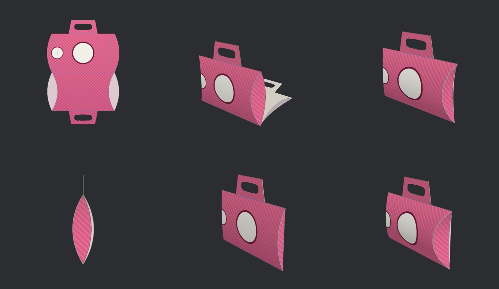
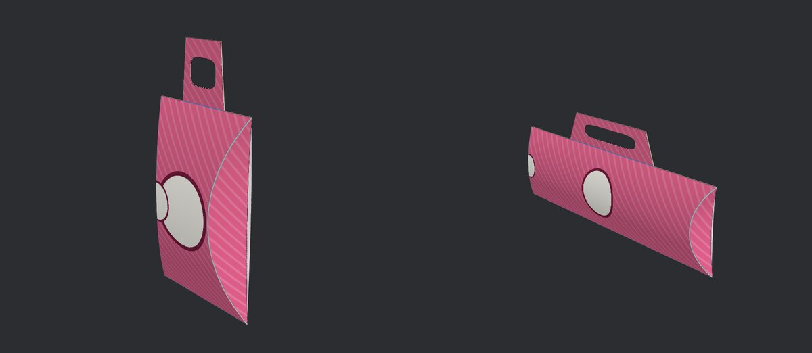
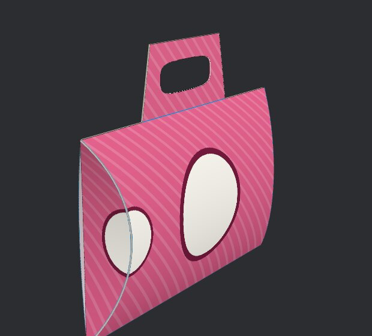

# 試作 S05: 曲線の折り線（持ち手つきピロー型）

これまで後回しにしてきた「曲線の折り線」を、持ち手つきピロー型（枕の形にふくらむ手提げ箱）で確かめるための、使い捨ての試作です。本番のコードや画面ではありません。



上段は左から、展開図、組み立ての途中、組み上がった状態。下段は左から、真横から見た状態、ふくらみ 30 度、ふくらみ 90 度です。



左は横 110 mm、面の高さ 170 mm。右は横 260 mm、面の高さ 80 mm。どちらも同じ型から、数値だけ変えて作っています。



左端から見たところ。小さい円が、曲線の折り線をまたいで、面からフラップへ続いています。

## 確かめること

1. 曲線の折り線を、これまでの型紙のデータ（パネルの木）のまま扱えるか
2. 曲線の折り線をまたいで、絵柄がつながるか
3. 横の長さ、面の高さ、ふくらみ、紙の厚みを数値で変えても、形が破綻しないか

## 動かし方

```
cd spikes/s05-pillow
cargo run --release
```

検算用のテストは `cargo test --release` です。起動時の状態は、これまでの指定に加えて次のものを指定できます。

| 指定 | 内容 |
|---|---|
| `--sides 10` | ピロー型（何も指定しなければピロー型で起動します） |
| `--bulge 度` | ふくらみ。ピロー型は 15〜90 |
| `--width mm` | 幅（ピロー型では横の長さ） |
| `--height mm` | 高さ（ピロー型では 1 枚の面の高さ） |

## 画面でできること

- 型に「ピロー型」を追加。横の長さ、面の高さ、ふくらみ、紙の厚みを変えられます。いちばん厚いところの寸法を、スライダーの下に表示します。
- 展開図では、曲線の折り線も、ほかの折り線と同じ青で表示します。PSD で保存した型紙のガイドにも入ります。
- これまでの型（ゲーブル型、丸みのある手提げ型、差し込み箱、正多角柱）もそのまま選べます。
- ピロー型は、お客さんが開ける動きをまだ持っていません（下の「割り切ったところ」を参照）。

## 仕組み

### 型の構成

| パネル | 内容 |
|---|---|
| 正面、背面 | 下の折り線でつながった 2 枚。それぞれ丸くふくらんで、上の端で合わさる |
| 正面の持ち手、背面の持ち手 | 面の上の端から山折りで立ち上がり、背中合わせに重なる。抜き穴つき |
| 正面のフラップ（左右）、背面のフラップ（左右） | 面の左右の端から、曲線の折り線で内側へ折り込む。背面のものが下、正面のものが上に重なる |

### 曲線の折り線

まっすぐな折り線は、「折り線を軸に、子のパネルを回す」で表せます。曲線の折り線はこれができません。紙を曲線で折ると、折り線の両側が必ず丸まるからです。

そこで、次の考え方にしました。

1. 面を丸めたとき、曲線の折り線が、立体の中で 1 枚の平面に乗るようにする
2. フラップは、「面をそのまま延長した形」を、その平面を鏡にして映した位置に置く

鏡に映した形は、もとの形と同じ寸法なので、紙は伸び縮みしません。折り線の上では、面とフラップがぴったりつながります。

ピロー型では、この平面が、箱の端で 45 度に傾いた面になります。面を延長した部分は横方向へ伸びていますが、45 度の鏡で映すと、奥行き方向へ向きが変わります。これが、ピロー型の端のくぼんだ壁です。

データの上では、フラップは「親のパネル」と「折り線上の 3 点」を持つだけです。3 点が乗る平面を計算して、そこで映します。パネルの木、厚みの扱い、絵柄の貼り方、描画は、これまでと同じものをそのまま使っています。

### 寸法

ピロー型は、横の長さ、面の高さ、ふくらみ、紙の厚みの 4 つの数値から、型紙全体を作ります。

- ふくらみは、1 枚の面が下から上までに向きを変える角度です。大きいほど厚い箱になります。
- 曲線の折り線の形は、ふくらみと面の高さから自動で決まります。面を丸めたときに、ちょうど 45 度の平面に乗る形を、式で求めています。
- フラップの長さは、折り線の深さの 1.8 倍です。向かいの面の近くまで届きます。
- 背面のフラップは正面のフラップの下に入るので、折り線を紙の厚みの 1.5 倍だけ内側へずらしています。

## 結果（2026-11-21、Linux、仮想画面、ソフトウェア描画）

| 項目 | 結果 |
|---|---|
| 展開図の状態では、フラップが面と同じ平面にある（鏡で映す処理が、平らなときに何もしない） | テストで確認 |
| 組み上がったとき、正面と背面の上の端が、内側の面どうしでぴったり合わさる | テストで確認（ふくらみ 3 通り） |
| 丸めても、面の高さ（紙の上での長さ）が変わらない | テストで確認 |
| 2 枚の持ち手が、紙の厚みの範囲で背中合わせに重なる | テストで確認 |
| 組み上がったとき、折り線の上でフラップと面がぴったりつながる | テストで確認 |
| フラップが、折り線から奥行き方向へまっすぐ倒れ込む（折り線から 5 mm 先の点が、奥へ 5 mm） | テストで確認 |
| 組み立ての途中（5 段階）でも、フラップと面のずれが 0.3 mm 未満 | テストで確認（実測の最大は約 0.19 mm） |
| これまでの型のテスト（S04 までの 10 件）が、そのまま通る | テストで確認 |
| 展開図、組み立ての途中、組み上がった状態、寸法とふくらみを変えた状態の見た目 | 画面を撮って確認（上の画像） |
| 折り線をまたぐ円（左の小さい円）が、フラップへ続く | 画面を撮って確認（3 枚目の画像） |

テストは 12 件で、すべて通っています。Windows と実機の GPU では、まだ動かしていません。

## 実物との違い

実物は手元になく、展開図の配布サイトの説明をもとにしています（出典は S04 の README）。

| 実物の持ち手つきピロー型 | この試作 |
|---|---|
| のりしろで筒にする。位置は未確認 | のりしろなし。下は 1 本の折り線、上は 2 枚の持ち手を貼り合わせる想定 |
| フラップの縁に、指をかける半円の切り欠きがあることが多い | 切り欠きは省略 |
| 曲線の折り線は、円弧で描かれていることが多い | 式で求めた曲線（円弧に近いが、同じではない） |

## 割り切ったところ

- 面の丸まり方は、きれいな円弧だと仮定しています。実際の紙は、折り線の近くと中央で曲がり方が少し違います。
- 折り線の形は「ふくらみから逆算する」向きにしか作っていません。「すでにある型紙の折り線の形から、ふくらみを求める」向きは未対応です。手持ちの型紙を読み込む機能を作るときに要ります。
- お客さんが開ける動き（フラップを外へ起こす）は未対応です。鏡で映す方法は「折り込んだ状態」しか表せず、面がふくらんだままフラップだけを起こす途中の形は、別の計算が要ります。
- 組み立ての途中では、折り線が 1 枚の平面にぴったりとは乗りません。ずれは 0.2 mm 程度で、見た目には分かりません。
- 曲面は、面もフラップも 24 分割の折れ面で近似しています。
- 持ち手の穴のふちには、紙の厚みの面を作っていません（S03 から同じ）。拡大すると、ふちに白い線が見えることがあります。

## 分かったこと

- 曲線の折り線は、「親のパネルの続きを、平面で映す」という 1 種類の置き方を足すだけで扱えました。パネルの木、厚み、絵柄、描画には手を入れていません。
- 絵柄は展開図の座標で持っているので、曲線の折り線をまたいでも、そのままつながります。
- ゲーブル型に続いてピロー型も、「数値から型紙を作る関数」として書けました。本番でも、型は「寸法を受け取って型紙を返すもの」として持てる見込みです。
- 残る課題は 2 つです。曲線の折り線を持つ型の「開ける動き」と、「折り線の形が先に決まっている型紙」の読み込みです。どちらも、最初の版に入れるかどうかを決める必要があります。

## ファイル

| ファイル | 内容 |
|---|---|
| `src/template.rs` | 型紙のデータ、5 種類の型、折りと丸めと鏡映しと開け閉めの計算、形の生成、テスト |
| `src/art.rs` | 確認用の絵柄、ガイド線、PSD の読み書き、テスト |
| `src/gpu.rs` | wgpu での描画 |
| `src/math.rs` | ベクトルと変換 |
| `src/app.rs` | ウィンドウ |
| `results/` | 上の結果を出したときの画像 |
