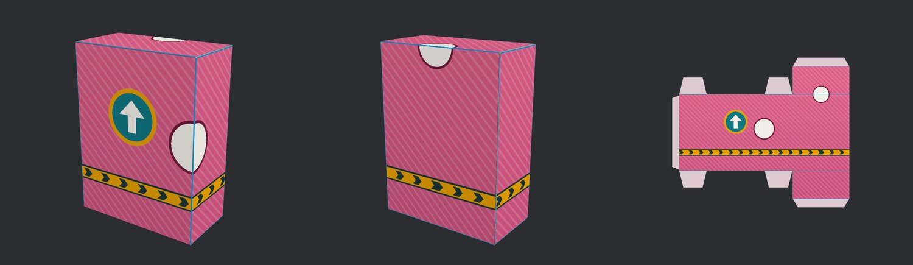
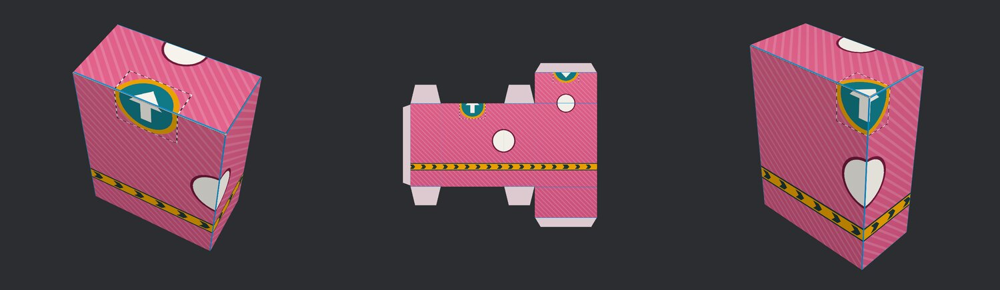
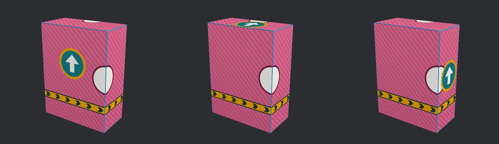
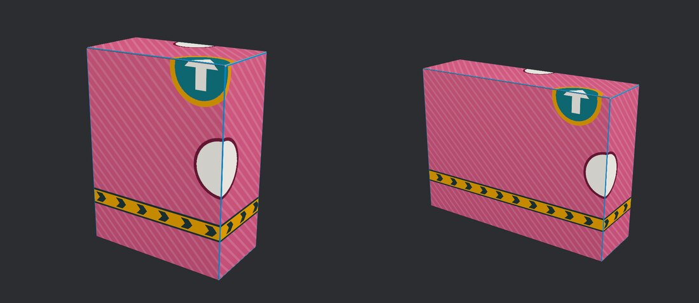
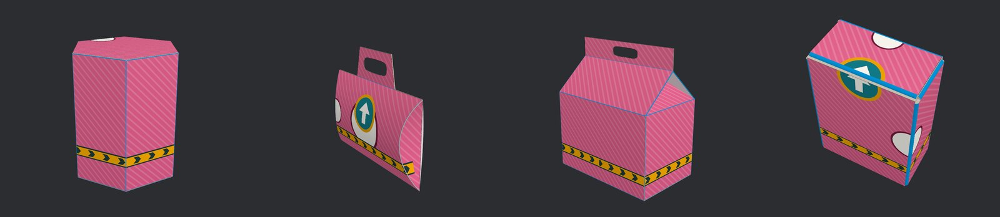

# 試作 S06: 立体の上で柄を置く

「立体の上で考える」を確かめるための、使い捨ての試作です。ロゴや帯のような柄を、箱の上で直接つかんで動かし、折り線や合わせ目をまたいで隣の面へ続けます。本番のコードや画面ではありません。



左から、正面、背面、展開図。帯は、正面に置いた 1 本の柄です。左右の側面を通って背面まで回り、背面の中央で両端が出会います。背面の左端は、のりしろの合わせ目（展開図では左右の端に離れている）ですが、帯はそのまま続いています。



左は、正面の上の端に置いたロゴ。フタへ続いています。中央は、同じ状態の展開図で、ロゴは離れた 2 か所（正面の上と、フタの先）に分かれて描かれています。右は、3 枚の面が集まる角に置いたとき。正面からフタ、正面から右側面へは続きますが、フタと右側面の間では切れます。



左が最初の状態。中央は、ロゴをつかんで上へ動かし、合わせ目を越えてフタの上まで運んだところ。右は、右側面へ運んだところ。どちらも、仮想画面の中でマウスの操作を再現して撮りました。



幅を 120 mm から 220 mm に変える前と後。ロゴは、正面の右上という「パネルの中での位置」を保ったまま付いてきます。大きさは変わりません。



左から、六角柱、ピロー型（帯が、曲線の折り線を越えて端のフラップへ続く）、ゲーブル型、厚み 3 mm の差し込み箱。

## 確かめること

1. 柄を「どのパネルの、どのあたり」で持てば、寸法を変えても付いてくるか
2. 立体の上で、柄をつかんで動かせるか
3. 柄が、折り線や合わせ目をまたいで、隣の面へ続くか
4. 合わせ目を、型ごとに手で書かずに、組み上がった形から自動で見つけられるか

## 動かし方

```
cd spikes/s06-decals
cargo run --release
```

検算用のテストは `cargo test --release` です。起動時の状態は、これまでの指定に加えて次のものを指定できます。

| 指定 | 内容 |
|---|---|
| `--logo パネル,横,縦,回転` | ロゴの場所。パネルの番号、パネルの中での位置（0〜1）、回転（度） |
| `--band パネル,横,縦,回転` | 帯の場所。書き方は同じ |
| `--png ファイル` | 画像を柄として置く |
| `--select 番号` | 起動時に選んでおく柄（0 が帯、1 がロゴ） |

何も指定しなければ、差し込み箱で起動します。

## 画面でできること

- **柄をつかんで動かす**: 箱の上の柄をドラッグすると、面の上を動きます。面の端を越えると、隣の面へ続きます。展開図の状態でも、組み立ての途中でも同じように動かせます。
- **箱を回す**: 柄のないところをドラッグします。
- **選ぶ**: 柄をクリックすると選べます。選んだ柄には点線の枠が付き、左の欄に、かかっている面の名前と、合わせ目をまたいだ回数が出ます。
- **幅、高さ、回転**: 選んだ柄を、左のスライダーで変えます。
- **足す、消す**: 「ロゴを足す」「帯を足す」「この柄を消す」。PNG をウィンドウにドロップすると、その画像が柄になります（透明な部分はそのまま透けます）。
- **寸法を変える**: 柄は、同じパネルの同じあたりに付いてきます。型を変えると、柄は最初の配置に戻ります。
- **PSD で保存**: 柄は、1 つにつき 1 枚のレイヤーに入ります（「立体の柄 1（帯）」「立体の柄 2（ロゴ）」のような名前）。この PSD を読み込み直すときは、ガイドと同じく、これらのレイヤーを除いて読みます（柄はソフトの中に、動かせる形で残っているため）。
- **展開図に戻す**: 視点が正面へ回り、印刷面が見える向きになります。「組み立てる」を押すと、元の視点に戻ります。

## 仕組み

### 柄の持ち方

柄は、次の 4 つで持ちます。

| 項目 | 内容 |
|---|---|
| 置かれているパネル | 柄の中心があるパネル |
| パネルの中での位置 | パネルを囲む四角の中での割合（左下が 0, 0、右上が 1, 1） |
| 大きさ | 幅と高さ（mm） |
| 回転 | 置かれているパネルの、展開図での向きを基準にした角度 |

寸法を変えて型紙を作り直しても、パネルの番号と割合は同じなので、柄は同じパネルの同じあたりに残ります。

### 隣の面への続き方

パネルどうしのつながりは 2 種類あります。

| つながり | 展開図の上では | 続け方 |
|---|---|---|
| 折り線（まっすぐなもの、曲線のもの） | 地続き | そのまま続く |
| 合わせ目 | 離れている | 隣のパネルの座標へ、回転と移動で写して続ける |

柄を描くときは、置かれているパネルから始めて、柄が境目の線にかかっている隣へ、近い順にたどります。たどり着いたパネルごとに、柄を「そのパネルから見た位置と向き」に直し、パネルの輪郭で切り抜いて描きます。

展開図の上で隣り合っているだけで、紙としてはつながっていない部分（切り線をはさんだ隣のフラップなど）へは、続きません。組み上がると隠れるパネル（のりしろ、差し込み）にも描きません。

### 合わせ目を自動で見つける

合わせ目は、型ごとに手で書いていません。組み上がった形の中で、「2 枚のパネルの辺が、同じ線の上に、逆向きに重なっている」ところを探します。

- 紙に厚みがあると、接する辺どうしが紙 1 枚ぶん離れて見分けにくくなります。そこで、同じ寸法で厚みだけをほぼ 0 にした型紙を作り、そちらで探します。辺の番号は厚みを変えても同じなので、見つけた組は元の型紙にそのまま使えます。
- 辺が重なっていても、どちらかのパネルが折り線で別の隣へ続いている部分は、合わせ目から除きます。たとえばピロー型の上の端は、中央では持ち手へ続き、その左右だけが背面との合わせ目です。

見つかる合わせ目は、次のとおりです（初期の寸法）。

| 型 | 合わせ目 |
|---|---|
| 差し込み箱 | 7 か所。のりしろの合わせ目（左側面と背面）と、上下のフタのまわり 3 辺ずつ |
| ゲーブル型 | 7 か所。のりしろの合わせ目、底のフタのまわり 3 辺、背中合わせの持ち手の上と左右 |
| ピロー型 | 4 か所。上の端（正面と背面）、背中合わせの持ち手の上と左右 |
| 丸みのある手提げ型 | 4 か所。同上 |
| 六角柱 | 11 か所。のりしろの合わせ目と、上下のフタのまわり 5 辺ずつ |

### 一周する帯と、角

同じパネルへ、別の道から着くことがあります。扱いは 2 通りです。

- **向きが同じで、位置だけが違う**（箱を一周して戻ってきた帯）: 両方とも描きます。差し込み箱の背面には、右まわりで着いた帯と、左まわりで合わせ目を越えて着いた帯の両方が乗り、中央で出会います。
- **向きが違って、重なる**（3 枚の面が集まる角）: 先に着いたほうだけを描きます。角のまわりは平らに開けないので、どこかで柄が切れます。

### 立体の上の点を求める

マウスの位置から視線を出し、立体の三角形と交わる点を求めます。交わった点の「展開図上の位置」が分かるので、そこからパネルを求めます。紙の内側や断面に当たったときは、何も置けません。抜き穴は素通りします。

つかんだ柄を別のパネルへ動かすとき、行き先のパネルにすでに柄がかかっていれば、その続き方のまま置き直します。これで、合わせ目を越える瞬間に、絵が飛んだり回ったりしません。

## 結果（2026-11-21、Linux、仮想画面、ソフトウェア描画）

| 項目 | 結果 |
|---|---|
| 差し込み箱の合わせ目 7 か所が、厚み 0.5 mm と 3 mm のどちらでも見つかる | テストで確認 |
| 合わせ目で写した先の点が、立体の中で元の点と同じ場所（紙の厚みの範囲）に来る | テストで確認 |
| 一周ぶんの長さの帯が、4 面すべてに乗り、背面の上で両端が出会う | テストで確認 |
| 角に置いたロゴが、正面、右側面、フタに 1 回ずつ乗る | テストで確認 |
| 寸法を変えても、柄が同じパネルの同じ割合の位置にあり、大きさが変わらない | テストで確認 |
| 合わせ目を越えて置き直しても、どのパネルでも絵の位置と向きが変わらない | テストで確認 |
| 視線から求めた点が、狙ったパネルの、狙った位置になる。箱の内側からは印刷面に当たらない | テストで確認 |
| 角柱、ゲーブル型の合わせ目。屋根のてっぺんのように、紙が隣へ続いている辺は合わせ目にならない | テストで確認 |
| ピロー型の上の端で、中央は持ち手へ、左右は背面へ続く | テストで確認 |
| 柄がパネルの外に描かれない。一周ぶんの帯の面積が見込みと合う | テストで確認 |
| 柄のレイヤーつきの PSD を保存でき、読み込むとそのレイヤーが除かれる | テストで確認 |
| ドラッグで柄が面の上を動き、合わせ目を越える。柄のないところのドラッグで箱が回る | 仮想画面でマウス操作を再現して確認 |
| 展開図の状態でも、ドラッグで柄を別のパネルへ動かせる | 仮想画面でマウス操作を再現して確認 |
| 幅のスライダーを動かすと、柄がパネルに付いてくる | 仮想画面でマウス操作を再現して確認 |
| PNG（透明つき）を柄として置ける | 起動時の指定で置いて、画面を撮って確認（ドロップの操作そのものは未確認） |

テストは 25 件で、すべて通っています。

## Windows での確認と、そのあとの修正（2026-11-21）

本人が Windows の実機で動かした結果です。

| 項目 | 結果 |
|---|---|
| 立体の上と展開図の上で、柄をつかんで動かす | 気持ちよく動く |
| PSD で保存して、外部アプリで開く | できた |
| 展開図に戻したとき | 箱の向きによっては、裏の白い面が見えてしまう |
| PSD の中の柄 | 全部が 1 枚のレイヤーにまとまっている |
| 寸法のスライダー | 反応が少し重い |
| ゲーブル型の側面の上の三角形 | つなぎ目に、のりしろが要るように見える |

これを受けて、次の 4 つを直しました（直したあとの確認は、Linux の仮想画面だけです）。

- **展開図に戻すときの視点**: 正面へ回るようにしました。組み立て直すと、元の視点に戻ります。
- **PSD の柄のレイヤー**: 柄 1 つにつき 1 枚にしました。描かれている範囲だけに切り詰めて入れます。
- **寸法を変えたときの重さ**: 確認用の絵柄を、行ごとに、複数のスレッドで塗るようにしました。PSD を読み込んでいるときは、寸法を変えるたびに PSD を読み直していたのを、大きさを合わせ直すだけにしました（この環境で、1 回あたり 27〜50 ミリ秒が 4〜8 ミリ秒に）。
- **ゲーブル型の斜めの線**: 側面の上の斜めの線は、1 枚の紙に入った折り線です。切り線の色で描いていたのを、折り線の色に直しました。

次のものは、本番で扱います。

- **角での優先**: 3 枚の面が集まる角で、どちらの面のつながりを優先するかを選ぶ（旧版にあった機能）。
- **スナップ**: 3 つの面を合わせるときに、位置を吸い付かせる。
- **型紙の誤り**: ゲーブル型とピロー型の、のりの扱い（方針メモの 4 章に記録）。

## 割り切ったところ

- **描き方**: 柄は、展開図の画像（1 mm あたり 4 画素、約 100 dpi）に描き込んでいます。動かすたびに展開図まるごとを作り直して送り直します（この環境で 1 回あたり約 8 ミリ秒）。大きく拡大すると、柄がぼやけます。本番では、柄ごとに元の解像度のまま描く形にします。
- **位置の持ち方**: 位置は「パネルを囲む四角の中での割合」だけです。「上の端から 10 mm」のような、端からの距離で持つ指定はありません。
- **大きさ**: mm で固定です。箱を大きくすると、一周していた帯は一周しなくなります。「箱に合わせて一周させる」指定は別に要ります。
- **回転の数値**: 置かれているパネルの、展開図での向きが基準です。合わせ目を越えると、見た目は変わらないのに数値が変わります（フタの上では 180 度になる、など）。本番では、見た目の向きを基準にします。
- **角**: 3 枚の面が集まる角では、近い道が優先されて、残りの境目で柄が切れます。どこで切るかは選べません。
- **丸めたパネルの辺**: 合わせ目として見つかるのは、まっすぐなまま重なる辺だけです。丸まった辺どうしが沿っているところは、見つからないことがあります。
- **内側**: 柄を置けるのは印刷面（外側）だけです。
- **操作**: 大きさと回転はスライダーだけで、柄の角をつかむ操作はありません。重なり順の入れ替え、元に戻す、保存して次に開く、もありません。
- **型を変えたとき**: 柄は最初の配置に戻ります。

## 分かったこと

- 柄を「パネルと、その中での位置」で持つ形は、成り立ちます。寸法を変えても付いてきて、型紙を作り直す処理には手を入れずに済みました。
- 合わせ目は、組み上がった形から自動で見つけられます。型を作る人が「どの辺とどの辺が接するか」を書く必要は、今のところありません。型紙の読み込みや自作の型にも、そのまま使える見込みです。
- 折り線も合わせ目も「隣のパネルへの写し方」として同じ形で持てるので、またぎ方の処理は 1 つで済みます。曲線の折り線（ピロー型の端）も、同じ仕組みで越えられました。
- 立体の上の点は、表示用の三角形と視線の交わりで求められます。展開図、組み立ての途中、組み上がった状態のどれでも、同じ処理で動きます。
- 展開図まるごとの絵（PSD で行き来するもの）と、立体の上で置く柄は、別の層として重ねられます。PSD には別のレイヤーとして出せます。
- 残る課題は、柄を元の解像度のまま描くこと、角での切れ方を選べるようにすること、位置と大きさの持ち方を増やすこと（端からの距離、箱に合わせて伸びる帯）です。

## ファイル

| ファイル | 内容 |
|---|---|
| `src/decal.rs` | 柄のデータ、合わせ目の検出、面のつながり、柄の割り振りと描き込み、立体の上の点の計算、テスト |
| `src/template.rs` | 型紙のデータ、5 種類の型、折りと丸めの計算、形の生成、テスト（S05 と同じ） |
| `src/art.rs` | 確認用の絵柄、ガイド線、PSD の読み書き、テスト |
| `src/gpu.rs` | wgpu での描画（S05 と同じ） |
| `src/math.rs` | ベクトルと変換（S05 と同じ） |
| `src/app.rs` | ウィンドウと、柄の操作 |
| `results/` | 上の結果を出したときの画像 |
